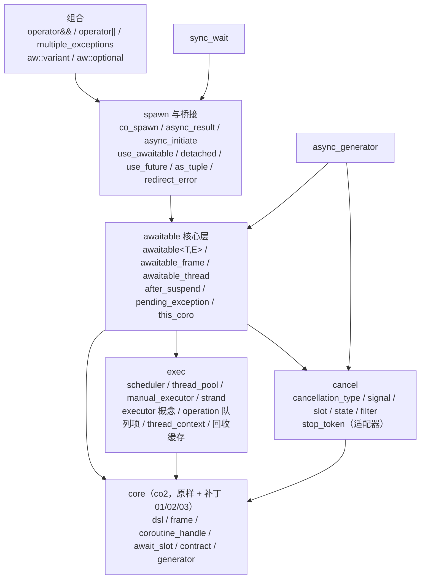
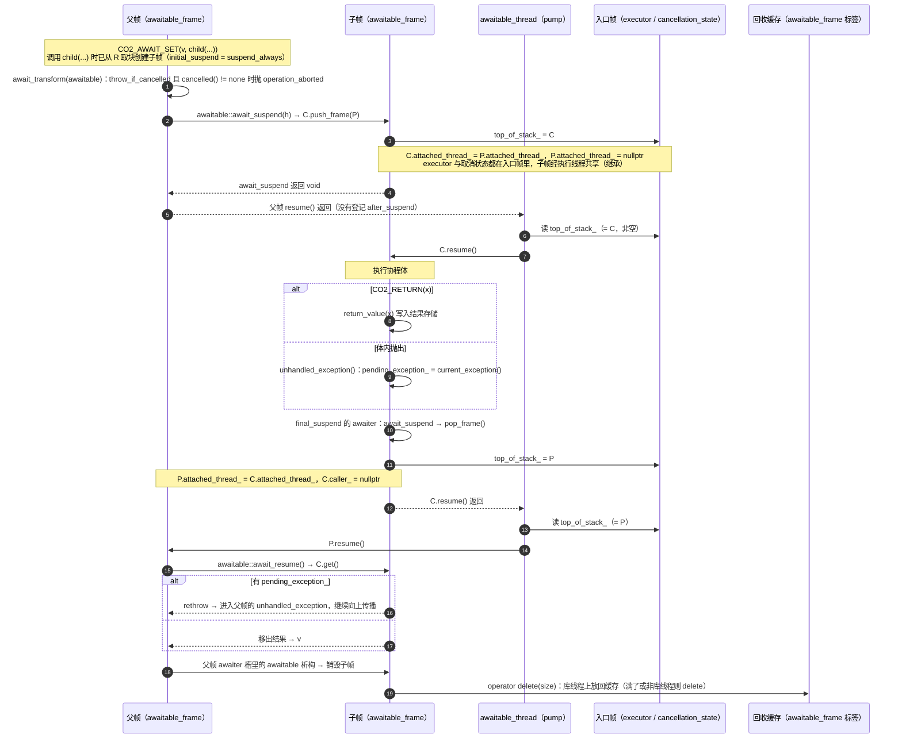
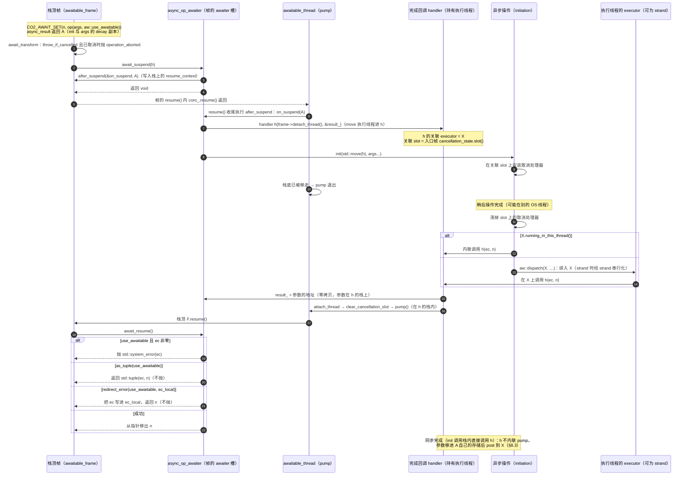

# awaitable 设计规格（v1）

- 日期：2026-11-12
- 状态：设计已批准；§16 的 12 项于 2026-11-12 由用户确认按推荐答案定案（“同意你的推荐”）。本文是实现计划的输入，只定义规格，不含实现代码。
- 仓库：`/workspace/awaitable`（分支 `main`）
- 上游依据：
  - coro（co2）`0be5ab2`，以及 `/workspace/coro-issues` 的 01 / 02 / 03 三个补丁。
  - asio `190a8d8`（asio 1.39.0）。文中 asio 路径都相对 `asio/include/asio/`，行号对应这个提交。
  - 研究笔记 Page「asio 协程实现学习：为基于 co2 宏协程的 awaitable 新库做准备」。

## 0. 术语

| 术语 | 含义 |
| --- | --- |
| core | 从 coro 搬来的 C++14 宏协程核心：宏 DSL、帧、`coroutine_handle`、awaiter 槽、契约检查。命名空间仍是 `co2`，宏仍是 `CO2_*`。 |
| 帧（frame） | 一次协程调用的状态。由 `CO2_BEG … CO2_END` 生成，包含帧头、promise、参数副本、局部列表和 awaiter 槽。 |
| 执行线程（thread of execution） | 一条逻辑执行流，对应 asio 的 `awaitable_thread`。它持有一个帧栈：栈底是入口帧，栈顶是正在运行或刚挂起的帧。它和 OS 线程无关。 |
| 入口帧 | 帧栈的栈底。保存执行线程的 executor、取消状态、栈顶指针和 throw_if_cancelled 标志，对应 asio 的 `awaitable_frame<awaitable_thread_entry_point>`。 |
| pump | 反复恢复栈顶帧的循环，直到栈空或执行线程对象被移走。 |
| 库线程 | 由本库驱动的 OS 线程：`thread_pool` 的工作线程，以及调用 `manual_executor::run` / `run_one` / `poll` 期间的调用线程。 |
| 热路径 | 下列操作在稳态下的一次执行：等待一个子 awaitable、一次异步桥接、一次 `co_spawn` 加完成回调、一次 strand 投递、`async_generator` 的一次 yield。 |

本文的命名空间约定：新库代码在 `aw` 命名空间（已定决策 §16 D1），core 仍在 `co2`。

## 1. 目标与非目标

### 1.1 目标

1. **协程机制。** 继续使用 co2 的 C++14 宏协程，不依赖编译器的协程支持。最低标准是 C++14，在 C++17 / C++20 下同样干净。
2. **core 原样复用。** core 从 coro `0be5ab2` 原样搬过来，只叠加 01 / 02 / 03 三个补丁，除此之外不改语义。
3. **任务层照搬 asio。**
   - 执行模型：`awaitable_thread`、帧栈、pump、`after_suspend`。
   - 取消：`cancellation_signal` / `slot` / `state`。
   - 错误通道：异常跨帧传递，配合 `as_tuple` / `redirect_error`。
   - executor 亲和与 strand。
   - 帧回收缓存。
   - `co_spawn` 和完成 token。
   - `||` / `&&` 运算符。
4. **保留并迁移的模块。**
   - `async_generator`：对外用法保留，改为挂到消费者的执行线程上运行。
   - `scheduler` + `thread_pool` + `manual_executor`：保留，并补上 `dispatch` / `post` / `running_in_this_thread`。新增 `strand`。
5. **性能（验收标准见 §15）。**
   - 分配次数不多于 asio。
   - 等待子协程、异步桥接的耗时不超过 asio 的 1.2 倍。
   - 打开回收缓存后，热路径零分配。

### 1.2 非目标（明确不做）

| 不做 | 原因 |
| --- | --- |
| 协程体内跨挂起点的 `try` / `catch` | 宏状态机的 `case` 标签不能落进 `try` 块（coro README「与语言级协程的差别」）。替代方案见 §7.4。 |
| 带参 `operator new(size, args...)` 的分配器 | co2 的宏拿不到完整的参数类型列表（coroutine-core-v2.md D4 / D9）。补丁 02 已把这种写法变成编译错误。 |
| `CO2_BEG_WITH_ALLOCATOR` 对 `aw::awaitable` 生效 | promise 自带 `operator new(size_t)` 时，core 优先用它（frame.hpp `FrameMemory`），allocator 实参被忽略，这与 C++20 的规则相同。不做编译期拦截，原因见 §9.4。 |
| HALO（帧分配消除） | 需要编译器参与。分配代价靠回收缓存压低。 |
| 捕获型 lambda 协程 | 协程体是局部类的成员函数，引用外层捕获会编译报错（实测报 `reference to local variable 'k' declared in enclosing function`）。无捕获 lambda 可以用，捕获的值改成参数传入。 |
| `any_io_executor` 类型擦除、Networking TS / P0443 双 executor 模型 | asio 的历史包袱（impl/co_spawn.hpp:35-73）。本库只有一种 executor 概念（§5.1）。 |
| `deferred` 与默认完成 token | 不在批准范围内。每个异步操作都必须显式传 token。 |
| `experimental::coro`、`co_composed`、`experimental::promise` | 只保留一种协程类型 `aw::awaitable`。 |
| work 计数（`executor_work_guard`） | 本库的执行上下文不会因为“没有活”而退出，所以不需要。见 §12 第 21 行。 |

## 2. 分层与目录

### 2.1 模块依赖图



依赖规则：

- 图中箭头之外不允许有任何依赖。
- core 不依赖任何上层。
- exec 和 cancel 互不依赖。

### 2.2 目录

```
include/
  awaitable.hpp                    总头文件：包含下列全部公共头
  awaitable/
    core/                          coro 搬来的核心（命名空间 co2）
      config.hpp contract.hpp coroutine_handle.hpp coroutine.hpp dsl.hpp generator.hpp
      detail/ await_slot.hpp awaitable.hpp frame.hpp move_only_function.hpp
              over_aligned.hpp preprocessor.hpp result_storage.hpp ring_queue.hpp
              uninitialized.hpp
    exec/                          scheduler.hpp executor.hpp thread_pool.hpp manual_executor.hpp
                                   strand.hpp post.hpp dispatch.hpp
                                   detail/ operation.hpp thread_context.hpp recycling_allocator.hpp
    cancel/                        cancellation_type.hpp cancellation_signal.hpp
                                   cancellation_state.hpp stop_token.hpp stop_token_adapter.hpp
    impl/                          awaitable_frame.hpp awaitable_thread.hpp entry_point.hpp
                                   async_op_awaiter.hpp handlers.hpp parallel_group.hpp
                                   generator_frame.hpp
    awaitable.hpp  this_coro.hpp  error.hpp  async_result.hpp  associated.hpp
    co_spawn.hpp  use_awaitable.hpp  detached.hpp  use_future.hpp
    as_tuple.hpp  redirect_error.hpp  operators.hpp  multiple_exceptions.hpp
    variant.hpp  optional.hpp  async_generator.hpp  sync_wait.hpp
tests/
  legacy/        coro 的 22 个测试与 4 个 compile-fail（原样）及其测试专用夹具（§12.1）
  differential/  原生 C++20 差分测试
  asio_parity/   与 asio 的行为对照
  unit/          新层的单元测试与契约违规测试
  stress/        并发压测
benchmarks/
docs/
```

每个公共头都必须能单独包含（沿用 coro 的 header self-containment 测试）。

## 3. core：搬哪些、不搬哪些

### 3.1 搬运步骤（实现计划第一步）

1. 准备 core 源码：
   1. 取 `/workspace/coro` @ `0be5ab2` 的干净拷贝。
   2. 按 01 → 02 → 03 的顺序打上 `/workspace/coro-issues/0{1,2,3}-*/fix.patch`。
   3. 结果应与 `/workspace/coro-fix` @ `36b9fe0` 的树一致。
2. 把 §3.2 列出的文件复制到 `include/awaitable/core/`。只做一种机械修改：把 `#include "co2/…"` 改成 `#include "awaitable/core/…"`。命名空间、宏名、代码内容都不变。
3. 用 §3.3 标为“测试夹具”的文件建 `tests/legacy/include/co2/`，这些文件**不做任何改动**（include 仍写 `co2/…`）。对 §3.2 的每个 core 文件，在夹具的同名路径放一个一行的转发头（例如 `tests/legacy/include/co2/detail/frame.hpp` 只含 `#include "awaitable/core/detail/frame.hpp"`），夹具和测试源文件因此能原样编译。
4. coro 的测试源文件（补丁后）原样复制到 `tests/legacy/`，同样不改。

### 3.2 搬入 core（原样）

| 文件（coro 中的路径） | 用途 | 打了哪个补丁 |
| --- | --- | --- |
| `include/co2/config.hpp` | 版本与平台宏 | — |
| `include/co2/contract.hpp` | `CO2_CONTRACT_CHECK` 与契约处理器（退出码 86） | — |
| `include/co2/coroutine_handle.hpp` | `coroutine_handle<P>`、`noop_coroutine`、`suspend_*`、迭代式 `resume()` 蹦床（:64） | — |
| `include/co2/coroutine.hpp` | core 聚合头 | — |
| `include/co2/dsl.hpp` | `CO2_BEG` / `CO2_END` / `CO2_AWAIT*` / `CO2_YIELD` / `CO2_RETURN` / `*_MEMBER` / `*_WITH_ALLOCATOR` | — |
| `include/co2/generator.hpp` | 同步 `Generator`，只依赖 core。`generator_begin_twice` 测试和差分测试需要它 | — |
| `include/co2/detail/await_slot.hpp` | 64 B awaiter 槽，超过时退回堆分配 | — |
| `include/co2/detail/awaitable.hpp` | `operator co_await` 查找（含 `__cpp_impl_coroutine` 分支）、`getAwaiter` | 02 |
| `include/co2/detail/frame.hpp` | 帧布局、ramp（`runRamp`）、promise 要求检查 | 01、02 |
| `include/co2/detail/move_only_function.hpp` | 测试夹具的 `callback.hpp` 和 storage_tests 要用。新层不使用 | — |
| `include/co2/detail/over_aligned.hpp` | 超对齐分配（C++14 没有对齐版 `new`） | — |
| `include/co2/detail/preprocessor.hpp` | 宏工具 | — |
| `include/co2/detail/result_storage.hpp` | 值 / 异常的结果存储 | — |
| `include/co2/detail/ring_queue.hpp` | exec 层队列 | — |
| `include/co2/detail/uninitialized.hpp` | 延迟构造存储（补丁 01 的 ramp 用到） | — |

补丁 03 只修改 `sync_wait.hpp`、`spawn.hpp`、`when_all.hpp`、`task.hpp` 和基准文件，都不在 core 里。所以 03 对 core 没有影响，它的做法由新层继承：`aw::sync_wait` 采用 03 的三态 phase 协议（§10）；03 的测量结论（分配约占 10–15% 的开销）是回收缓存的依据。

### 3.3 不搬入库

| 文件 | 去向 | 被什么取代 |
| --- | --- | --- |
| `task.hpp` | 只进测试夹具 | `aw::awaitable<T, E>` |
| `spawn.hpp`（`spawn` / `JoinHandle`） | 只进测试夹具 | `aw::co_spawn` + 完成 token |
| `when_all.hpp` | 只进测试夹具 | `aw::operator&&` |
| `callback.hpp`（`fromCallback`） | 只进测试夹具 | `aw::async_initiate` + `use_awaitable` |
| `sync_wait.hpp` | 只进测试夹具 | `aw::sync_wait`（重写） |
| `env.hpp`（`getStopToken` / `inheritStopToken`） | 原版进测试夹具；这两个函数移植到 `cancel/stop_token_adapter.hpp` | §6.4 |
| `detail/late_init.hpp` | 只进测试夹具 | 新层不需要（它只被 spawn / when_all 使用） |
| `co2.hpp` | 只进测试夹具 | `include/awaitable.hpp` |
| `scheduler.hpp` / `thread_pool.hpp` / `manual_executor.hpp` | 原版进测试夹具；修改版进 `exec/`（命名空间 `aw`） | — |
| `stop_token.hpp` | 原版进测试夹具；内容原样进 `cancel/stop_token.hpp`，命名空间改为 `aw` | — |
| `async_generator.hpp` | 原版进测试夹具；`aw::async_generator` 重写 | — |

“测试夹具”指 `tests/legacy/include/co2/`。它只用于运行 coro 原有的测试，不安装，不进总头文件，库代码不得包含它。

## 4. awaitable 核心层

### 4.1 `aw::awaitable<T, Executor>`

```cpp
namespace aw {
template <class T, class Executor>
class awaitable {                       // 只能移动，[[nodiscard]]
public:
    using value_type = T;
    using executor_type = Executor;
    awaitable(awaitable&&) noexcept;
    ~awaitable();                       // 帧还没启动时销毁它
    bool valid() const noexcept;
    // awaiter 协议：只能在同一 Executor 的 awaitable 帧里被等待（由 await_transform 保证）
    bool await_ready() const noexcept { return false; }
    template <class P> void await_suspend(co2::coroutine_handle<P>);   // push_frame，返回 void
    T await_resume();                   // get()：取值或重抛 pending_exception
private:
    detail::awaitable_frame<T, Executor>* frame_;
};
}
```

- `T` 可以是 `void`、对象类型或左值引用。
- 只能在同一 `Executor` 类型的 awaitable 帧里等待，对应 asio awaitable.hpp:64、107-129。
- `Executor` 没有默认值，见已定决策 §16 D4。库提供别名：

```cpp
template <class T = void> using pool_awaitable   = awaitable<T, thread_pool::executor_type>;
template <class T = void> using manual_awaitable = awaitable<T, manual_executor::executor_type>;
```

**写法示例**（这是 CO2 宏写法，不是实现）：

```cpp
using ex_t = aw::thread_pool::executor_type;

auto add_twice(connection& c) CO2_BEG(aw::awaitable<std::size_t, ex_t>, (c),
                                       std::size_t a{}; std::size_t b{};) {
    CO2_AWAIT_SET(a, c.async_read(aw::use_awaitable));
    CO2_AWAIT_SET(b, c.async_read(aw::use_awaitable));
    CO2_RETURN(a + b);
}
CO2_END

auto parent(connection& c) CO2_BEG(aw::awaitable<void, ex_t>, (c), std::size_t n{};) {
    CO2_AWAIT_SET(n, add_twice(c));      // 等待子协程：push_frame
    CO2_RETURN();
}
CO2_END
```

### 4.2 `awaitable_frame_base<Executor>`：promise 基类

`awaitable` 和 `async_generator` 共用这个基类。

| 成员 | 作用 | asio 对应 |
| --- | --- | --- |
| `static void* operator new(std::size_t)` / `operator delete(void*, std::size_t)` | 从回收缓存的 `awaitable_frame` 标签取块（§9） | impl/awaitable.hpp:100-116 |
| `initial_suspend()` → `suspend_always` | 创建时不运行 | :120-123 |
| `final_suspend()` → awaiter：`await_suspend` 调 `pop_frame()`，返回 void，noexcept | 出栈后回到 pump | :126-148 |
| `unhandled_exception()` | `pending_exception_ = std::current_exception()` | :156-159 |
| `rethrow_exception()` | 有 pending 就重抛 | :161-168 |
| `push_frame(caller)` / `pop_frame()` | 维护 `caller_`、`attached_thread_`、入口帧的 `top_of_stack_` | :480-495 |
| `attach_thread()` / `detach_thread()` | 执行线程对象的转交 | :470-478 |
| `resume()` | 在栈上放一个 `resume_context`，然后 `coro_.resume()`；返回后如果登记了 after_suspend 就调用它 | :497-510 |
| `after_suspend(fn, arg)` | 登记“挂起完成后要执行的函数” | :512-516 |
| `clear_cancellation_slot()` | 异步操作完成后清空当前 slot | :170-173 |
| `await_transform(...)` | 见 §4.3 | :175-443 |
| `envStopToken()` | stop_token 适配器入口（§6.4） | 本库新增 |
| 数据成员：`coroutine_handle<> coro_`、`awaitable_thread<E>* attached_thread_`、`awaitable_frame_base* caller_`、`std::exception_ptr pending_exception_`、`resume_context* resume_context_` | 与 asio 相同 | :523-528 |

`awaitable_frame<T, E>` 在基类之上加 `return_value` / `return_void`（按补丁 02 的要求只声明其中一个）、结果存储和 `get()`，对应 asio :531-603。

### 4.3 `await_transform` 规则

awaitable 帧里能 `CO2_AWAIT` 的只有下列几类，其余一律报错：

1. **同一 Executor 的 `awaitable<U, E>`。** 先检查取消：入口帧的 `throw_if_cancelled_` 为真，且 `cancellation_state.cancelled() != none` 时，抛出 `std::system_error(aw::error::operation_aborted)`。然后原样返回，对应 asio :175-182。
2. **`async_op_awaiter`**，即 `use_awaitable` 发起异步操作的结果（§8.3）。取消检查同上。
3. **`this_coro` 的各个标签**（§4.5）。`await_ready` 恒为真，不挂起，对应 asio :209-402。
4. **`async_generator<U, E>::next()` 的 awaiter**（§10.2）。取消检查同上。
5. **其他任何类型：`static_assert` 失败**，提示“awaitable 帧只能等待 awaitable / use_awaitable 操作 / this_coro / async_generator::next()”。

第 5 条和 co2 core 的 D9（匹配不上就原样等待）相反，是有意为之：原样等待一个 `co2::ScheduleOn` 或 `suspend_always`，会绕过执行线程直接恢复帧，破坏帧栈与 executor 亲和。实现时用一个兜底模板加 `static_assert`。

### 4.4 `awaitable_thread<Executor>`：执行线程

```cpp
template <class Executor>
class awaitable_thread {                // 只能移动；完成回调持有它（§8.3）
public:
    awaitable_thread(awaitable<awaitable_thread_entry_point, Executor> entry, Executor ex,
                     cancellation_slot parent_slot = {});
    awaitable_thread(awaitable_thread&&) noexcept;
    ~awaitable_thread();                // 没跑完就被丢弃时，经 executor 展开（unwind_through_executor）
    executor_type get_executor() const noexcept;                       // 关联 executor
    cancellation_slot_type get_cancellation_slot() const noexcept;     // 关联 slot = 入口帧取消状态的 slot()
    void launch();                      // 在线程上下文里标记“启动中”，然后 pump
    void pump();                        // do { 栈顶->resume(); } while (栈底 && 栈顶);  若栈底还在就 complete()
};
```

各项行为照搬 asio：

- `pump`：impl/awaitable.hpp:778-786。
- `complete`：:794-799。
- `launch`：:753-757，以及 impl/awaitable.ipp:31-43。
- `unwind_through_executor`：:763-774。
- 关联 executor / slot：:703、:747-750。

### 4.5 `this_coro`

```cpp
namespace aw::this_coro {
constexpr executor_t executor{};                                 // CO2_AWAIT_SET(ex, this_coro::executor);
constexpr cancellation_state_t cancellation_state{};             // 返回 aw::cancellation_state
reset_cancellation_state_0_t reset_cancellation_state();         // 默认过滤器：只接收 terminal
template <class F> reset_cancellation_state_1_t<F> reset_cancellation_state(F filter);
template <class In, class Out> reset_cancellation_state_2_t<In, Out>
    reset_cancellation_state(In in, Out out);
throw_if_cancelled_0_t throw_if_cancelled();                     // 读：返回 bool
throw_if_cancelled_1_t throw_if_cancelled(bool value);           // 写
}
```

对应 asio this_coro.hpp:28-61、:76-168，以及 impl/awaitable.hpp:209-402。

## 5. exec 层

### 5.1 Executor 概念

本库只有这一种 executor 模型。下表中 `ex` 是一个可复制的轻量句柄。

| 表达式 | 要求 |
| --- | --- |
| `ex.context()` | 返回执行上下文的引用 |
| `ex.post(f)` | 把 `f` 排队，绝不在调用者栈内执行。线程安全。 |
| `ex.dispatch(f)` | `running_in_this_thread()` 为真时在调用者栈内执行 `f`，否则等同 `post`。线程安全。 |
| `ex.running_in_this_thread()` | noexcept，表示当前 OS 线程是否正在执行这个上下文的任务 |
| `ex.schedule(h)` | 排队恢复一个 `co2::coroutine_handle<>`，零分配，noexcept。供 core 级协程和测试夹具使用。 |
| `ex == ex2` | 两个句柄是否指向同一个上下文 |

对 `f` 的要求：

- `f` 满足 `MoveConstructible`，调用签名是 `void()`。
- 排队时 `f` 被移进一个 `operation`，内存来自回收缓存的 `executor_function` 标签。
- 如果 `f` 抛出异常，异常从“执行它的那次调用”传出（§7.5）。

### 5.2 `scheduler`（保留）

```cpp
namespace aw {
struct scheduler {
    virtual ~scheduler() = default;
    virtual void schedule(co2::coroutine_handle<> h) noexcept = 0;            // 原接口，保留
    virtual void post(detail::operation* op) noexcept = 0;                    // 新增
    virtual bool running_in_this_thread() const noexcept = 0;                 // 新增
};
template <class Context> class basic_executor;      // executor_type 的通用实现，保存 Context*，非虚调用
struct schedule_on_awaiter { scheduler* s; /* 原 ScheduleOn awaiter，只给 core 级协程用 */ };
inline schedule_on_awaiter schedule_on(scheduler& s) noexcept;   // 原 scheduleOn，见 §16 D3
}
```

- `thread_pool` 和 `manual_executor` 都声明为 `final`。它们的 `executor_type = basic_executor<Self>` 直接调用具体类，没有虚调用开销。
- `scheduler` 这个虚接口留给 core 级协程和第三方上下文使用。
- awaitable 帧里不能等待 `schedule_on`（§4.3 第 5 条）。要在 awaitable 帧里换 executor，用 §7.3 的写法。

### 5.3 队列项：协程句柄与普通函数分开

- 队列元素仍是 `void*`，用最低位作标记：
  - 0：帧地址，即 `co2::coroutine_handle<>`。帧头至少按指针对齐。
  - 1：`detail::operation*`。
- `operation` 的结构是 `{ void (*complete)(operation*, bool invoke); }`：
  - `invoke=true` 时执行并释放；
  - `invoke=false` 时只销毁、不执行，用于关闭阶段。
- 普通函数和执行线程的恢复（完成回调里移动持有的 `awaitable_thread`）都走 `operation`。

### 5.4 `thread_pool`（保留，修改）

保留 coro 的全部调度结构：每个 Worker 一个本地 Chase-Lev 队列、全局队列、偷取和停车。修改点如下：

1. 队列项按 §5.3 改为带标记的项。
2. 新增 `executor_type get_executor()`，以及 `running_in_this_thread()`，后者由原来的 `isWorkerThread()` 改名。
3. 每个 Worker 在线程入口建立 `thread_context`，同时拥有这个线程的回收缓存（§9.2）。
4. **异常策略照搬 asio：** 任务里逸出的异常导致 `std::terminate()`。workerMain 继续保持 noexcept，对应 asio impl/thread_pool.ipp:32-45。
5. **析构：**
   1. 停止接收新任务，唤醒并 join 全部工作线程。
   2. 排空所有队列：`operation` 以 `invoke=false` 销毁；销毁过程中新投递的项同样立即销毁。
   3. 队列里如果还有协程句柄项，属于契约违规（沿用 coro `ManualExecutor` 的销毁契约）。

### 5.5 `manual_executor`（保留，修改）

1. 队列项改为带标记的项。
2. 新增 `get_executor()`、`poll()`（只执行已经就绪的项）和 `running_in_this_thread()`。只有在 `run` / `run_one` / `poll` 调用期间，在调用线程上它才返回真。
3. `run` / `run_one` / `poll` 在调用期间建立 `thread_context`，所以调用线程在这段时间里算库线程。
4. `run` / `run_one` 不是 noexcept：任务的异常传给调用者，与 asio `io_context::run` 一致。
5. 析构规则与 §5.4 第 5 条相同。

### 5.6 `strand<Executor>`（新增）

```cpp
template <class Executor> class strand {
public:
    explicit strand(Executor inner);
    Executor const& get_inner_executor() const noexcept;
    // 满足 §5.1 的全部要求；running_in_this_thread() 表示“当前 OS 线程正在执行这个 strand 的任务”
};
template <class Executor> strand<Executor> make_strand(Executor const& ex);
```

- 结构照搬 asio 的 `strand_executor_service`（detail/strand_executor_service.hpp:40；impl 文件 :254-291）：
  - 共享的 `strand_impl` 包含互斥锁、`locked` 标志、就绪队列和等待队列；
  - `locked` 为假时，向内层 executor 投递一个 invoker，由它排空就绪队列；
  - 线程局部的 strand 调用栈支持 `running_in_this_thread`。
- `strand_impl` 用 `shared_ptr` 共享。invoker 的内存来自回收缓存的 `executor_function` 标签。
- **保证：** 同一个 strand 上的任务互不并发，并按投递顺序执行。

### 5.7 自由函数

```cpp
template <class Executor, class Token> auto post(Executor const& ex, Token&& token);
template <class Executor, class Token> auto dispatch(Executor const& ex, Token&& token);
```

- 签名是 `void()`，按 §8 的完成 token 机制工作。
- `CO2_AWAIT(aw::post(ex, aw::use_awaitable))`：让出执行权，稍后回到本执行线程的 executor 上继续。

## 6. cancel 层

### 6.1 类型

```cpp
namespace aw {
enum class cancellation_type : unsigned { none = 0, terminal = 1, partial = 2, total = 4, all = 0xFFFFFFFFu };
// 按位运算 | & ^ ~ 以及 operator! 都提供
class cancellation_signal {                     // 不可复制、不可移动
public:
    void emit(cancellation_type type);          // 调用已安装的处理器；没有处理器就什么也不做
    cancellation_slot slot() noexcept;
};
class cancellation_slot {                       // 轻量句柄，可复制
public:
    template <class H, class... Args> H& emplace(Args&&...);   // 一个 slot 同时只能有一个处理器，替换旧的
    template <class H> std::decay_t<H>& assign(H&&);
    void clear();
    bool is_connected() const noexcept;
    bool has_handler() const noexcept;
};
template <cancellation_type Mask> struct cancellation_filter;  // operator()(type) 返回 type & Mask
using disable_cancellation        = cancellation_filter<cancellation_type::none>;
using enable_terminal_cancellation = cancellation_filter<cancellation_type::terminal>;
using enable_partial_cancellation  = cancellation_filter<cancellation_type::terminal | cancellation_type::partial>;
using enable_total_cancellation    = cancellation_filter<cancellation_type::terminal | cancellation_type::partial | cancellation_type::total>;
class cancellation_state {
public:
    cancellation_state() noexcept;                                      // 不连接任何父 slot
    template <class In = enable_terminal_cancellation, class Out = In>
    cancellation_state(cancellation_slot parent, In in = {}, Out out = {});
    cancellation_slot slot() const noexcept;                            // 交给当前异步操作的子 slot
    cancellation_type cancelled() const noexcept;                       // 已收到的取消类型（位掩码）
    void clear(cancellation_type mask = cancellation_type::all) noexcept;
};
}
```

对应的 asio 代码：

- cancellation_type.hpp:57-63；
- cancellation_signal.hpp:88、99、123、150-198；
- cancellation_state.hpp:31-70、80、99-101、169-197。

`cancellation_slot` 处理器的内存来自回收缓存的 `cancellation_signal` 标签；新处理器大小不超过旧块时直接复用旧块，与 asio 相同。

### 6.2 取消规则

1. **取消状态的位置。** 每个执行线程在入口帧里有一个内部 `cancellation_signal` 和一个 `cancellation_state`，后者挂在前者的 slot 上，也就是父 slot。默认过滤器是 `enable_terminal_cancellation`。外部取消从这个内部 signal 进来：
   - `co_spawn` 的 token 带关联 slot 时，外部 emit 经 dispatch 转到这里（§8.2）；
   - `||` / `&&` 的子执行线程例外：父 slot 直接是组状态里的 signal（不经内部 signal，也不经 co_spawn 的取消桥），组状态先 dispatch 到子执行线程的 executor 再 emit（§6.3）。
2. **送达当前操作。** 帧发起异步操作时，完成回调的关联 slot 就是 `cancellation_state.slot()`。操作在这个 slot 上安装自己的处理器。操作完成后，回调在恢复协程前调用 `clear_cancellation_slot()`。
3. **记录。** 父 slot 上 emit 的类型先经过 in 过滤器写进 `cancelled()`，再经过 out 过滤器转给当前操作的 slot。
4. **throw_if_cancelled 默认开**（asio impl/awaitable.hpp:615）。只要 `cancelled() != none`，下一次 `CO2_AWAIT` 会在发起之前抛出 `operation_aborted`（§4.3）。用 `this_coro::throw_if_cancelled(false)` 可以关闭。
5. **重置。** `reset_cancellation_state(...)` 用新的过滤器重建入口帧的取消状态，并清除已记录的取消。
6. **三级语义**，与 asio 相同：
   - `terminal`：操作完成后，对象只能关闭或销毁；
   - `partial`：对象状态被定义为可能有部分副作用；
   - `total`：保证不产生任何副作用。
   具体操作支持哪几级，由操作自己声明。
7. **线程要求。** `cancellation_signal::emit` 和 slot 都不是线程安全的。必须在被取消操作所在的 executor 上调用。从别的线程取消，要先 `post` 到那个 executor。`co_spawn` 自己装的父 slot 处理器会先 `dispatch` 到协程的 executor，再 emit（§8.2）。

### 6.3 组合中的取消

- 父执行线程收到的取消，会转给 `||` / `&&` 的所有子执行线程。
- 某个子线程决出结果后，其余子线程收到 `cancellation_type::all`，与 asio `wait_for_one` / `wait_for_one_success` / `wait_for_one_error` 的默认值相同（experimental/cancellation_condition.hpp:41-69）。
- 两个子执行线程的入口帧嵌在组状态那一块内存里（`mem_tag::parallel_group`），不单独分配。组状态按引用计数释放：两个入口帧各一份、交付一份、每个在途的 emit 操作一份。所有对子执行线程的 emit（父取消转发、决出结果后的取消）都先 `dispatch` 到组的 executor，这与 co_spawn 取消桥的 `spawn_cancellation_handler` 语义相同。（2026-11-13 验收修订第 2 项）

### 6.4 stop_token 适配器

`stop_token` 只做适配器，存在的目的是让 `async_generator` 和旧代码里 `getStopToken` / `inheritStopToken` 的写法继续可用。

- **`aw::stop_token` / `stop_source` / `stop_callback`：** 内容与 coro 的 `stop_token.hpp` 相同，移入 `aw` 命名空间。
- **单向桥接：从 cancellation 到 stop_token。**
  1. 帧内第一次执行 `CO2_AWAIT_SET(tok, aw::get_stop_token())` 时，入口帧惰性创建一个 `stop_source`，状态内存来自 `cancellation_signal` 标签。
  2. 此后，取消状态的处理器每次收到通过 in 过滤器的非 none 取消，都会调用 `request_stop()`。
  3. 不提供反方向的桥接，即 `request_stop()` 不会转成 emit。
- **`envStopToken()`：** 返回借用这个 `stop_source` 的 `EnvStopToken`。`EnvStopToken` 随 `stop_token.hpp` 一起搬来（coro stop_token.hpp:336-376，`co2::detail::EnvStopToken`）。
- **函数移植：** coro env.hpp 的 `getStopToken()`（:19-21）和 `inheritStopToken(into, consumerHandle)`（:54-85）移植到 `stop_token_adapter.hpp`，正式名字是 `aw::get_stop_token` / `aw::inherit_stop_token`。同时提供同名的 CamelCase 内联转发，保证旧写法逐字可用。
- 如果没有人取过 token，适配器不分配内存，也不做任何事。

## 7. 错误通道与 executor 亲和

### 7.1 异常跨帧传递

1. 帧体抛出的异常被 `unhandled_exception` 存进本帧的 `pending_exception_`。帧随后照常走 final：`pop_frame`，回到父帧。
2. 父帧在 `await_resume` 里调用子帧的 `get()`：先把 `caller_` 置空，然后有异常就重抛，没有就取值（asio awaitable.hpp:125-129；impl/awaitable.hpp:570-576）。
3. 异常在父帧体内逸出，又被父帧的 `unhandled_exception` 捕获。如此逐层向上，直到入口帧。
4. 异步操作返回的 `std::error_code`（非零）或 `std::exception_ptr`（非空）在 `await_resume` 里转成异常：
   - `std::error_code` 转成 `std::system_error`；
   - `std::exception_ptr` 原样 rethrow。
   对应 impl/awaitable.hpp:885-936。

### 7.2 根：co_spawn 交付

1. **入口帧手写，不用宏协程。** asio 的 `co_spawn_entry_point` 是一个协程，靠 `try` / `catch` 包住 `co_await`（impl/co_spawn.hpp:133-186），宏协程做不到这一点。本库的入口帧是一个手写的帧，帧头兼容 core，可以被 pump 恢复。它的状态机是：

   ```
   派发中 → 运行用户帧 → 交付 → final
   ```

2. **交付形式：**
   - 用户帧返回 `T` 时，交付 `(std::exception_ptr, T)`；
   - 用户帧返回 `void` 时，交付 `(std::exception_ptr)`；
   - 有异常时 `T` 部分是值初始化的值；如果 `T` 不可默认构造，就是 `aw::optional<T>`（§8.4）。
3. **`detached` 默认重抛。** `detached` 收到非空的 `exception_ptr` 时，在交付点重抛。这是相对 asio 的偏离，asio 的 `detached_handler` 会忽略所有参数（impl/detached.hpp:30-41）。重抛之后：
   - 在 `manual_executor` 上，异常从 `run` / `run_one` 传给调用者；
   - 在 `thread_pool` 上，导致 `std::terminate()`（§5.4）。
   需要“吞掉异常”时，显式传一个忽略参数的回调。

### 7.3 executor 亲和

1. **绑定。** 执行线程在创建时绑定一个 executor，可以是 `strand`。帧栈里所有帧都只在这个 executor 上运行。
2. **完成后回到原 executor。** 完成回调的关联 executor 就是执行线程的 executor。异步操作完成时，必须经关联 executor 调用回调：
   - 用 `aw::dispatch(get_associated_executor(h, io_ex), …)`；
   - 当前已经在这个 executor 上时内联执行，否则排队。
   因此协程恢复时总是回到自己的 executor。这条要求写进 §8.1 的操作作者契约，测试用 `running_in_this_thread()` 断言。
3. **co_spawn 先 dispatch。** `co_spawn(ex, a, token)` 先 `dispatch` 到 `ex`，再 `launch()`，对应 impl/co_spawn.hpp:137。
4. **启动期完成先 post。** 如果用户帧在 `launch()` 的调用栈内就同步完成了（入口帧通过 `thread_context` 判断“启动中”），交付前先向 `ex` `post` 一次，避免在 `co_spawn` 的调用者栈里同步调用完成 token，对应 impl/co_spawn.hpp:149-154、174-179。
5. **交付到 token 的 executor。** 完成 token 自己有关联 executor 时，交付先 `dispatch` 到它，否则就在 `ex` 上交付，对应 impl/co_spawn.hpp:156-160。
6. **在别的 executor 上执行。** 帧不能中途换 executor。要在别处执行，就在那个 executor 上 `co_spawn` 一个子执行线程并等待它：`CO2_AWAIT_SET(r, aw::co_spawn(other, work(), aw::use_awaitable))`。只想让出执行权时，用 `CO2_AWAIT(aw::post(this_ex, aw::use_awaitable))`。
7. **strand。** 执行线程绑定 `strand<E>` 时，它的所有恢复都经过 strand，所以同一个 strand 上的多个执行线程互不并发。

### 7.4 没有跨挂起点 try / catch 时的错误处理

宏协程的挂起点不能出现在 `try` 块里，所以“捕获子协程或操作的错误”有下面三种做法：

| 需求 | 写法 |
| --- | --- |
| 拿到异步操作的错误码而不抛异常 | `CO2_AWAIT_SET(r, op(aw::as_tuple(aw::use_awaitable)))`，`r` 是 `std::tuple<std::error_code, T...>` |
| 把错误码写到变量里 | `CO2_AWAIT_SET(n, op(aw::redirect_error(aw::use_awaitable, ec)))`。`ec` 必须是帧局部变量（在 `CO2_BEG` 的局部列表里声明） |
| 拿到子协程的异常而不传播 | `CO2_AWAIT_SET(r, aw::co_spawn(this_ex, child(), aw::as_tuple(aw::use_awaitable)))`，`r` 是 `std::tuple<std::exception_ptr, T>`，代价是多一个入口帧 |
| 不跨挂起点的同步代码 | 照常 `try` / `catch` |

### 7.5 异常从哪里逸出

| 位置 | 行为 |
| --- | --- |
| 帧体 | 存入 `pending_exception_`，向父帧传播 |
| 入口帧 | 交给 token。只有 `detached` 会重抛 |
| 交付 token 时抛出（回调自己抛） | 从 pump 逸出，进入执行该任务的 run：`manual_executor` 传给调用者，`thread_pool` 导致 terminate |
| `post` / `dispatch` 的普通函数 | 同上 |
| final_suspend / 析构 / 取消处理器 | 必须 noexcept。补丁 02 对 final_suspend 有编译期检查 |

## 8. spawn 与桥接

### 8.1 完成 token 机制

```cpp
template <class Token, class... Signatures> struct async_result;   // 定制点
template <class Token, class Signature, class Initiation, class... Args>
auto async_initiate(Initiation&& init, Token& token, Args&&... args);
template <class T, class Default = void> struct associated_executor;          // T::executor_type / get_executor()
template <class T, class Default = cancellation_slot> struct associated_cancellation_slot;
template <class Executor, class H> auto bind_executor(Executor const&, H&&);
template <class H> auto bind_cancellation_slot(cancellation_slot, H&&);
```

- 支持的签名形式：`void()`、`void(std::error_code, T...)`、`void(std::exception_ptr, T...)`、`void(T...)`。
- 普通回调就是 token 本身：默认的 `async_result` 直接把它当回调传给 initiation。
- **操作作者契约**（用测试强制）：
  1. initiation 可以同步调用回调；这种情况的处理见 §8.3。
  2. 完成时必须经回调的关联 executor 调用它。
  3. 支持取消的操作，要在回调的关联 slot 上安装处理器，并在完成前清掉。
  4. 回调最多调用一次。不调用就销毁回调，等于放弃这个执行线程，结果见 §11。

**写一个异步操作的示例：**

```cpp
template <class Token>
auto async_wait_ready(event& e, Token&& token) {
    return aw::async_initiate<Token, void(std::error_code)>(
        initiate_wait{&e}, token);       // initiate_wait::operator()(Handler&&) 登记回调
}
```

### 8.2 `co_spawn`

```cpp
template <class Executor, class T, class Token>
auto co_spawn(Executor const& ex, awaitable<T, Executor> a, Token&& token);
template <class Context, class T, class Token>       // Context 有 get_executor()
auto co_spawn(Context& ctx, awaitable<T, typename Context::executor_type> a, Token&& token);
```

- **签名：** 完成签名是 `void(std::exception_ptr, T)`，`T` 为 `void` 时是 `void(std::exception_ptr)`。
- **只接受 awaitable 对象**，不接受“返回 awaitable 的函数对象”。原因是捕获型 lambda 协程不做，函数对象形式没有额外价值。
- **支持的 token：**
  - 回调：任何可调用对象；
  - `aw::detached`：默认重抛（§7.2）；
  - `aw::use_future`：返回 `std::future<T>`，异常经 future 交付；
  - `aw::use_awaitable`：在另一个 awaitable 里等待它；
  - `as_tuple(...)` / `redirect_error(...)` 修饰上述 token。
- **取消：** token 有关联 slot 时，`co_spawn` 在那个 slot 上安装处理器。处理器先 `dispatch` 到 `ex`，再在入口帧的内部 signal 上 emit。
  - 因为处理器可能在执行线程结束之后才被执行，桥接状态是一个小的引用计数块，来自 `cancellation_signal` 标签。只有 token 带 slot 时才分配。
  - 对应 asio impl/co_spawn.hpp:240-291、319-329。
- **分配：** 一次 `co_spawn` 分配两块：用户帧和入口帧。入口帧里放执行线程状态、token 回调、取消状态。打开回收缓存后，两块都来自缓存。

### 8.3 `use_awaitable`：异步操作桥接

```cpp
template <class Executor = void> struct use_awaitable_t { /* 标签；Executor=void 时取执行线程的 executor */ };
constexpr use_awaitable_t<> use_awaitable{};
```

- `async_result<use_awaitable_t<>, Sig>::initiate(init, token, args...)` 返回一个 `async_op_awaiter<Sig, Init, Args...>`。
  - 它保存 `init` 和 `args` 的 decay 副本，所以表达式里的临时对象可以安全使用（core D10）；
  - 这里**不**像旧版 asio `use_awaitable` 那样再创建一个 initiate 协程帧（impl/use_awaitable.hpp:190-230），而是照搬 `awaitable_async_op` 的直接 awaiter 做法（impl/awaitable.hpp:184-207、1020-1085）。
- **时序：**
  1. `await_suspend` 只调用 `after_suspend(&on_suspend, this)`，返回 void。
  2. 帧的 `resume()` 返回以后，`on_suspend` 执行：先 `handler h{frame->detach_thread(), &result_}`（回调移动持有执行线程对象），再 `init(std::move(h), args...)`。
  3. pump 看到栈底已被移走，退出。
- **完成：**
  1. 回调被调用时，参数在回调的栈上。回调把参数的地址写进 awaiter 的 `result_`，即一个指针，不拷贝。
  2. 然后依次 `attach_thread`、`clear_cancellation_slot`，并在回调的栈内 `pump()`。
  3. 帧恢复后在 `await_resume` 里从这个指针移出结果。
  4. 对应 impl/awaitable.hpp:840-858。
- **同步完成：** initiation 在自己的调用栈内直接调用了回调（同一线程、`on_suspend` 还没返回）。这时回调不在栈内 pump，而是把执行线程 `post` 到它的 executor，以避免无限递归。判断依据是 `thread_context` 里的“正在发起”标记。参数要先移进 awaiter 自己的存储，此时多一次移动、零分配，这条路不再是零拷贝。这与 asio 的默认做法一致：关联的 immediate executor 缺省就是 executor 加上 never-blocking 语义（associated_immediate_executor.hpp:34-184）。
- **awaiter 大小：** `async_op_awaiter` 放在帧的 awaiter 槽里（64 B）。超过 64 B 时退回 core 的堆分配，会被计数分配器统计。热路径零分配的验收（§15）要求标准测试操作的 awaiter 不超过 64 B。

### 8.4 `as_tuple` / `redirect_error` / `use_future` / `detached`

| token | 修饰后的结果 | asio 对应 |
| --- | --- | --- |
| `as_tuple(t)` | 完成签名 `void(Args...)` 变成 `void(std::tuple<Args...>)`，不再把错误转成异常 | as_tuple.hpp:37 |
| `redirect_error(t, ec)` | 剥掉签名里的第一个 `error_code` / `exception_ptr`，写进 `ec` 引用 | redirect_error.hpp:36 |
| `use_future` | `std::future<T>`，或 `std::future<std::tuple<…>>` | use_future.hpp:61 |
| `detached` | 什么也不交付；只在有异常时重抛（偏离） | detached.hpp:39、101 |

如果 `T` 不可默认构造，异常路径无法给出一个“值”。这时 `co_spawn` 的完成签名改用 `aw::optional<T>`（C++17 及以上就是 `std::optional`）。

### 8.5 两条数据流的时序图

#### ① 等待子协程：`CO2_AWAIT_SET(v, child(...))`

规则依据：§4.2、§4.3 第 1 条、§4.4、§7.1、§9.2。



#### ② 等待异步操作：`CO2_AWAIT_SET(n, op(args, aw::use_awaitable))`

规则依据：§4.3 第 2 条、§6.2 第 2 条、§7.3 第 2 条、§8.3、§8.4。



## 9. 帧与分配

### 9.1 帧布局

- core 的帧布局不变，顺序是：帧头 → promise → 参数副本 → 局部列表 → awaiter 槽 → allocator。
- `awaitable_frame_base` 让 promise 多出 5 个字：`coro_`、`attached_thread_`、`caller_`、`pending_exception_`、`resume_context_`，在 64 位上是 40 B。
- 入口帧另外保存：executor（一个指针大小）、`top_of_stack_`、父 slot、`cancellation_state`、`throw_if_cancelled_`、启动标记、token 回调，以及 `T` 的结果存储。
- 实现计划要用 `offsetof` / `sizeof` 探针，把各类帧的实际大小记进基准报告。

### 9.2 回收缓存（照搬 asio thread_info_base）

| 项 | 规格 | asio 依据 |
| --- | --- | --- |
| 拥有者 | 每个库线程一个 `thread_info`，挂在 `thread_context` 调用栈上 | thread_info_base.hpp:45；impl/awaitable.ipp:31-43 |
| 标签 | `default`、`awaitable_frame`、`executor_function`、`cancellation_signal`、`parallel_group` | thread_info_base.hpp:58-128 |
| 每个标签的格数 | 2（`AW_RECYCLING_ALLOCATOR_CACHE_SIZE`，默认 2） | :36-38 |
| 粒度 | 4 字节为一块（chunk）。分配时多要 1 字节，把块数写在 `mem[size]` 上，归还时搬到 `mem[0]`。块数超过 255 的请求不进缓存 | :163-186、226-243、310-314 |
| 命中条件 | 缓存块的块数够用，并且对齐满足要求 | :163-186 |
| 生效范围 | 只在库线程上生效（§0）。其他线程直接对齐 new / delete | :232-271 |
| 跨线程释放 | 释放时放进“当前线程”的缓存；当前线程不是库线程就直接 delete | 同上 |
| 线程退出 | 释放缓存里的所有块 | thread_info_base 析构 |
| 关闭开关 | `AW_DISABLE_RECYCLING_ALLOCATOR`：全部走对齐 new / delete，供计数和对照用 | `ASIO_DISABLE_AWAITABLE_FRAME_RECYCLING` |

### 9.3 各处分配一览（打开缓存后的稳态）

| 操作 | 分配 | 来源标签 |
| --- | --- | --- |
| 创建 awaitable 帧 | 1 | `awaitable_frame` |
| 等待子 awaitable | 0（子帧已经由调用创建） | — |
| 异步桥接（awaiter ≤ 64 B） | 0 | — |
| `post` / `dispatch` 普通函数 | 1 个 operation | `executor_function` |
| 恢复一个执行线程（回调排队） | 1 个 operation | `executor_function` |
| `co_spawn` | 2（用户帧 + 入口帧）；token 带 slot 时 +1 | `awaitable_frame`、`cancellation_signal` |
| `a && b` / `a \|\| b` | 1 个组状态（内含两个操作数的入口帧）；另有两个子执行线程的取消状态处理器和父 slot 上的 1 个转发处理器。操作数帧和运算符协程帧算在“创建 awaitable 帧”里 | `parallel_group`、`cancellation_signal` |
| strand 投递 | 1 个 operation；invoker 复用 | `executor_function` |
| `async_generator` 一次 yield | 0 | — |
| 取消处理器 emplace | 复用旧块；第一次 1 块 | `cancellation_signal` |

“热路径零分配”指：上表的每一项都由缓存满足，全局 `operator new` 的调用次数为 0。1000 层嵌套这类同时活着的帧超过 2 个的场景不受这个约束，只要求分配次数不多于 asio。

### 9.4 与 core 分配机制的关系

- `awaitable_frame_base` 声明了 `operator new(std::size_t)`，所以 core 的 `FrameMemory` 会优先用它。这一点满足补丁 02 的检查：声明了 `operator new` 就必须有 `operator new(std::size_t)`。
- 对 awaitable 用 `CO2_BEG_WITH_ALLOCATOR` 时，allocator 被忽略、帧仍走回收缓存，这与 C++20 的规则相同：promise 的 `operator new` 不接受 allocator 参数时，allocator 不起作用。
- 不做编译期拦截：allocator 既不传给 promise 构造函数，也不暴露给 promise（dsl.hpp:54-80），要拦截就得改 core，违背“core 原样”。这一条写进文档的“不要这样用”。

## 10. async_generator 与 sync_wait

### 10.1 `aw::async_generator<T, Executor>` 对外接口

```cpp
template <class T, class Executor> class async_generator {   // 只能移动
public:
    next_awaiter next() noexcept;      // CO2_AWAIT_SET(item, gen.next());  item 是 aw::optional<T>
    ~async_generator();                // 停在 yield 处或还没启动时可以销毁（迭代式中途销毁）
};

auto numbers(int n) CO2_BEG((aw::async_generator<int, ex_t>), (n), int i{};) {
    for (i = 0; i != n; ++i) CO2_YIELD(i);
    CO2_RETURN();
}
CO2_END

auto consume() CO2_BEG(aw::awaitable<int, ex_t>, (), aw::async_generator<int, ex_t> g{numbers(3)};
                       aw::optional<int> v{}; int sum{};) {
    for (;;) {
        CO2_AWAIT_SET(v, g.next());
        if (!v) break;
        sum += *v;
    }
    CO2_RETURN(sum);
}
CO2_END
```

`next()` 返回 `aw::optional<T>`（已定决策 §16 D5）。这是对 coro 接口的有意修改：coro 的 `CO2_AWAIT_SET(hasValue, g.next())` 返回 `bool`，再用 `value()` 取值；迁移时改成 `CO2_AWAIT_SET(v, g.next())`，用 `if (!v)` 判断结束，用 `*v` 取值。旧的 `bool` 加 `value()` 接口不保留。

命名对照（已定决策 §16 D2）：coro 的 `AsyncGenerator` / `ThreadPool` / `ManualExecutor` / `Scheduler` / `syncWait` / `scheduleOn` 在新库里分别是 `aw::async_generator` / `aw::thread_pool` / `aw::manual_executor` / `aw::scheduler` / `aw::sync_wait` / `aw::schedule_on`。CamelCase 名字只存在于测试夹具 `tests/legacy/include/co2/`。

### 10.2 执行模型

1. **next 时压栈。** `next_awaiter::await_suspend` 把生成器帧 `push_frame` 到消费者帧之上，返回 void，然后由 pump 恢复生成器。生成器从此运行在消费者的执行线程里，executor、取消状态、回收缓存都取自消费者的执行线程。
2. **yield 时出栈，值不额外拷贝。**
   1. `CO2_YIELD(e)` 的 awaiter 把被 yield 对象的地址写进消费者 `next_awaiter` 的指针字段，然后 `pop_frame()` 回到消费者。
   2. 被 yield 的对象：左值直接取地址；纯右值按 core D11 移进生成器帧保存。
   3. 消费者的 `await_resume` 从这个指针 move 构造 `optional<T>`。全程只有这一次 move。
3. **结束。** 生成器 `CO2_RETURN()` 后走 final，`pop_frame`，`next()` 返回空的 optional。生成器体内的异常存进它的 `pending_exception_`，在消费者的 `await_resume` 里重抛。
4. **生成器体内等待异步操作。** 用法与 awaitable 相同，因为两者共用 `awaitable_frame_base` 和 §4.3 的 `await_transform`。
5. **取消。** `throw_if_cancelled` 和 `cancelled()` 读的是消费者执行线程的入口帧。生成器体内的 `get_stop_token()` 走 §6.4 的适配器。旧写法 `inheritStopToken` 通过 `envStopToken()` 继续有效。
6. **销毁契约。**
   - 生成器停在 yield 处、还没启动、或已经结束时，都可以销毁，析构时销毁它的帧。
   - 生成器正在执行，或挂起在某个异步操作上（也就是它在帧栈里），这时销毁是契约违规，沿用 coro 的 `async_generator_destroy_contract_violation`。
7. **同一时刻最多一个未完成的 `next()`**，违反就是契约违规。

### 10.3 `sync_wait`

```cpp
template <class T, class Executor> T sync_wait(Executor const& ex, awaitable<T, Executor> a);
template <class T> T sync_wait(manual_executor& ctx, awaitable<T, manual_executor::executor_type> a);
```

- **第一种形式：**
  1. 内部 `co_spawn` 到 `ex`，交付给一个栈上的状态对象，然后阻塞调用线程。
  2. 状态对象采用补丁 03 的协议：原子 `phase { running, finished, parked }`，加上互斥锁保护的 `notified`。完成方只有在看到 `parked` 时才加锁。等待方先做一次快速 load，再在锁内用 CAS 把 `running` 改成 `parked`。
  3. 前置条件：`!ex.running_in_this_thread()`，违反就是契约违规，否则会死锁。
- **第二种形式：** 在调用线程上驱动 `ctx.run_one()`，直到交付完成。
- **异常：** 异常经 `exception_ptr` 在调用线程重抛。

## 11. 线程安全契约

| 对象 | 契约 |
| --- | --- |
| 帧（`awaitable_frame` 及其 promise） | 没有任何同步。同一时刻只有持有执行线程对象的那一方能访问它。 |
| `awaitable<T, E>` | 只能移动，最多被等待一次。还没启动时可以在任何线程销毁（会销毁帧）。 |
| `awaitable_thread` | 只能移动。所有权在 pump 和完成回调之间转移。同一时刻最多一个 OS 线程在 pump 它。 |
| 丢弃执行线程（回调没被调用就被销毁） | 析构时把整个帧栈的销毁 `post` 到它的 executor（`unwind_through_executor`），在那里从栈底开始销毁：父帧的 awaiter 槽持有子 awaitable，析构时逐层销毁子帧。执行上下文正在关闭时，销毁立即内联进行（§5.4）。 |
| executor 的 `post` / `dispatch` / `schedule` | 线程安全 |
| `manual_executor::run` / `run_one` / `poll` | 同一时刻只能有一个驱动线程 |
| `strand` | `post` / `dispatch` 线程安全；任务互不并发、保持 FIFO |
| `cancellation_signal` / `slot` / `state` | 不是线程安全的。必须在被取消操作的 executor 上使用（§6.2 第 7 条） |
| `co_spawn` 安装的父 slot 处理器 | 可以在任何线程被 emit，内部先 dispatch 到协程的 executor |
| `stop_source` / `stop_token` / `stop_callback` | 线程安全（与 coro 相同） |
| 回收缓存 | 线程局部，不同步 |
| `async_generator` | 与消费者在同一个执行线程上运行，不需要额外同步 |

## 12. 与 asio 的逐项对照

asio 版本是 `190a8d8`。

| # | 机制 | 结论 | 本库的做法 / 原因 | asio 依据 |
| --- | --- | --- | --- | --- |
| 1 | 执行线程持有帧栈 | 一致 | `awaitable_thread` 只持有栈底，入口帧保存栈顶 | impl/awaitable.hpp:51-85、663-802 |
| 2 | pump | 一致 | `do 栈顶->resume() while (栈底 && 栈顶)` | :778-786 |
| 3 | co_await 子协程 | 一致 | `await_suspend` 调 `push_frame`，返回 void，由 pump 恢复子帧 | awaitable.hpp:107-123；impl/awaitable.hpp:480-486 |
| 4 | final 时出栈 | 一致 | final awaiter 调 `pop_frame` | :126-148、488-495 |
| 5 | after_suspend | 一致 | 帧 `resume()` 用栈上的 `resume_context` | :497-516 |
| 6 | 回调持有执行线程、参数零拷贝、在回调栈内 pump | 一致 | — | :804-1018、840-858 |
| 7 | 直接 awaiter 桥接 | 一致（取 `awaitable_async_op` 的做法） | 不为 `use_awaitable` 额外创建 initiate 协程帧 | :1020-1085；对照 impl/use_awaitable.hpp:190-230 |
| 8 | 同步完成 | 一致（语义） | 发起期间完成就 post 恢复，等价于 immediate executor 的默认行为 | associated_immediate_executor.hpp:34-184 |
| 9 | 入口帧 | **偏离（形式）** | 手写帧而不是协程。原因：宏协程不能跨挂起点 `try` / `catch` | impl/co_spawn.hpp:133-186 |
| 10 | co_spawn 先 dispatch，启动期完成先 post | 一致 | — | impl/co_spawn.hpp:137、149-154、174-179 |
| 11 | co_spawn 的取消处理器 | 一致 | 只在 token 带 slot 时分配引用计数块 | impl/co_spawn.hpp:240-291 |
| 12 | `detached` | **偏离** | 有异常时重抛，asio 是忽略。原因：已定决策，不让异常静默丢失 | impl/detached.hpp:30-41 |
| 13 | 异常传播 | 一致 | `pending_exception_` 加上 `get()` 重抛 | :150-168、570-576 |
| 14 | error_code 转异常 | 一致 | — | :885-936 |
| 15 | 取消三级与 filter | 一致 | — | cancellation_type.hpp:57-63；cancellation_state.hpp:31-70 |
| 16 | throw_if_cancelled 默认开 | 一致 | — | impl/awaitable.hpp:175-207、615 |
| 17 | `reset_cancellation_state` | 一致 | — | :713-735；this_coro.hpp:76-140 |
| 18 | slot 一次只有一个处理器 | 一致 | — | cancellation_signal.hpp:123-198 |
| 19 | stop_token | **新增** | 只做单向适配器，用于兼容 async_generator 的旧写法 | （asio 没有） |
| 20 | executor 模型 | **偏离（简化）** | 只有一种概念：`post` / `dispatch` / `running_in_this_thread` / `schedule`。没有 `any_io_executor`，没有 TS / P0443 双模型。原因：历史包袱 | impl/co_spawn.hpp:35-73 |
| 21 | work 计数 | **偏离（不做）** | 执行上下文不会因为“没有活”而退出 | impl/co_spawn.hpp:35-111 |
| 22 | strand | 一致 | 结构照搬 `strand_executor_service` | detail/strand_executor_service.hpp:40；impl :254-291 |
| 23 | 帧回收缓存 | 一致 | 2 格、4 字节粒度、只在库线程上生效 | thread_info_base.hpp:36-38、163-271；impl/awaitable.hpp:100-116 |
| 24 | thread_pool 中逸出的异常 | 一致 | `std::terminate` | impl/thread_pool.ipp:32-45 |
| 25 | `\|\|` / `&&` 语义 | 一致 | `&&` 是 wait_for_one_error，`\|\|` 是 wait_for_one_success，其余操作数收到 `cancellation_type::all`；`&&` 两边都失败时抛 `multiple_exceptions`（带第一个异常） | experimental/awaitable_operators.hpp:75-300；cancellation_condition.hpp:41-69；multiple_exceptions.hpp:26 |
| 26 | `\|\|` / `&&` 实现 | **偏离（形式）** | 不经过 `deferred` 和通用 `parallel_group`，直接为每个操作数生成子执行线程，加一个手写组状态。原因：不做 `deferred`，而且更省 | experimental/impl/parallel_group.hpp:221-226 |
| 27 | variant / optional | **偏离（C++14）** | C++17 及以上别名到 `std::variant` / `std::optional`；C++14 下用自带的精简实现 | — |
| 28 | 默认 token、`deferred` | **偏离（不做）** | 必须显式传 token | deferred.hpp:602-628 |
| 29 | `co_spawn(ex, F)` 函数对象形式 | **偏离（不做）** | 捕获型 lambda 协程不做 | co_spawn.hpp:249+ |
| 30 | 分配器来自参数 | **偏离（不做）** | 宏拿不到参数类型 | experimental/detail/coro_promise_allocator.hpp:26-60 |
| 31 | 允许等待任意 awaiter | 一致（都拒绝） | awaitable 帧只接受指定的几类 | impl/awaitable.hpp:175-443 |
| 32 | std::experimental 和编译器 workaround | **不搬** | 历史包袱 | awaitable.hpp:37-43；impl/use_awaitable.hpp:177-225 |

## 13. 宏协程下的限制（使用者须知）

1. **跨挂起点的局部变量**必须写在 `CO2_BEG` 的局部列表里。体内直接声明的变量活不过挂起点（core D1）。`redirect_error` 的 `ec` 和 `async_generator` 对象都必须是帧局部变量。
2. **挂起点不能出现在**：
   - `try` 块里；
   - lambda 或嵌套函数里；
   - 协程体自己的 `switch` 里，这一条会编译报错（core D12，有 compile-fail 测试）。
3. **`CO2_AWAIT` 的位置**只能是语句或赋值右侧，一行一个（core D3）。表达式里含 lambda 时，用 `CO2_AWAIT_AS(T, e)`。
4. **临时对象。** awaitable 表达式里的临时对象活不过挂起点（core D10）。`use_awaitable` 的 awaiter 会 decay 复制所有参数，所以临时对象是安全的；需要传引用时显式用 `std::ref`。
5. **lambda 协程**只能用无捕获 lambda。捕获的值改成参数，写进捕获列表。
6. **成员函数协程**用 `CO2_BEG_MEMBER`，体内用 `self` 代替 `this`（core D13）。
7. **宏参数上限**：捕获最多 8 个；局部列表和 `CO2_RETURN` 的表达式里，顶层逗号总数不超过 64（core D14）。
8. **没有 HALO**：每个协程调用一次帧分配，打开缓存后由缓存满足。
9. **operator co_await** 在 C++14 下拼写为 `operator_co_await`（core D7）。
10. **awaitable 帧不能等待任意 awaiter**（§4.3）。

## 14. 测试计划

### 14.1 core 回归（`tests/legacy/`）

- **范围：** coro 的 22 个测试原样搬来，只改 include 路径。依赖的非 core 头文件来自测试夹具（§3.3）。另有：
  - 补丁 01 的回归用例 `exceptionsBeforeTheInitialAwaitResumeDestroyAnOwnedFrameOnce`，已经包含在 conformance_tests 里；
  - 补丁 02 的 4 个 compile-fail 测试。
- **22 个测试的构成：**
  - 11 个普通测试：conformance、storage、return_types、scheduler、thread_pool、stop_token、spawn、when_all、callback、allocation、edge_case；
  - 8 个契约违规测试，期望退出码 86：task_destroy、manual_executor、join_handle、generator_begin_twice、resume_running、thread_pool_zero_threads、async_generator_destroy、continuation_twice；
  - 2 个 compile-fail：await_inside_switch、member_macro_outside_member_function；
  - 1 个差分测试：differential，在 C++20 下构建。
- **合计：** 22 加 4 个新增 compile-fail 共 26 项，与 `/workspace/coro-fix` 一致；再加下面的 03 回归测试，legacy 的 ctest 共 27 项。
- **补丁 03 的回归：** 把 `/workspace/coro-issues/03-perf-alloc-sync/repro.cpp` 的分配计数逻辑改写成断言测试 `tests/legacy/issue03_allocation_counts_test.cpp`，对夹具编译，断言每次操作的分配次数：syncWait 1、syncWait(whenAll(2)) 5、spawn 3；并在 thread_pool 上跑一次“先等待后完成”的 syncWait。计时部分留在基准里。加上这一项，legacy 的 ctest 共 27 项（22 + 4 + 1）。新层的 `aw::sync_wait` 另外测“先完成后等待”和“先等待后完成”两种顺序（§14.3）。

### 14.2 原生差分测试（`tests/differential/`）

- coro 原有的 12 个协议追踪场景继续跑（已在 14.1 计入）。
- 新增帧栈原语的差分场景。用一个只依赖协议的最小 promise（push / pop、`await_suspend` 返回 void、after_suspend、final 时 pop），同一份场景描述分别实例化为 co2 宏协程和同编译器的原生 C++20 协程，逐事件比对追踪序列。
- 这部分在 C++20 下构建，使用 tests 的 `trace.hpp` 的 Lib 模板化方式。

### 14.3 与 asio 的行为对照（`tests/asio_parity/`）

- 同一个场景写两份：一份用 asio `190a8d8` 的原生协程（C++20），一份用本库的宏协程。各自产生事件追踪，然后断言两份追踪相同。asio 通过 CMake 选项 `AW_ASIO_ROOT` 指定，只用于测试和基准。
- 场景清单：
  1. 压栈出栈顺序：3 层嵌套，每层前后都打点。
  2. 异常：子帧抛出，父帧没有处理，一路传到 `co_spawn` 回调，比对 `exception_ptr` 的类型和消息。
  3. 三级取消：`terminal`、`partial`、`total` 分别配合三种过滤器。检查 `cancelled()` 的值、`throw_if_cancelled` 开 / 关时下一次等待的行为，以及 `reset_cancellation_state` 之后的行为。
  4. strand：N 个执行线程绑定同一个 strand，交替等待异步操作。断言互不重叠，并且投递顺序一致。
  5. `||` / `&&`：先完成者胜出、败者被取消；单边失败与双边失败（`multiple_exceptions`）；void 与非 void 的组合；三元链式组合。
  6. executor 亲和：异步操作在别的线程完成，恢复时 `running_in_this_thread()` 为真。
  7. co_spawn 启动期同步完成时，完成回调不在 `co_spawn` 的调用栈内执行。

### 14.4 单元测试与契约违规（`tests/unit/`）

- 覆盖每个模块的公共接口。
- 契约违规（期望退出码 86）：
  - 在 `ex` 自己的线程上调 `sync_wait(ex, …)`；
  - 同一个生成器同时有两个 `next()`；
  - 销毁正在帧栈中的生成器；
  - `manual_executor` 带着协程句柄项析构；
  - awaitable 帧里等待任意 awaiter（这一条是 compile-fail）。

### 14.5 构建矩阵

| 轴 | 取值 |
| --- | --- |
| 构建类型 | Debug、Release |
| 检测器 | ASan + UBSan、TSan |
| 标准 | C++14、C++17、C++20（`AW_TEST_CXX_STANDARD`）；差分测试和 asio 对照固定为 C++20 |
| 编译器 / 标准库 | clang + libstdc++、clang + libc++ |
| 告警 | 沿用 coro：`-Wall -Wextra -Wpedantic -Werror -Wconversion …` |

每个组合的全部 ctest 项都必须通过。

### 14.6 并发压测（`tests/stress/`）

- 对象：thread_pool、co_spawn 跨线程完成、strand、`||` / `&&` 的取消竞争、取消与完成同时到达、`sync_wait` 两种顺序。
- 轮数：Release 下每项 30 轮，TSan 下每项 10 轮，全部通过且零报告。

## 15. 基准计划与验收标准

### 15.1 基准项

1. 空协程的创建与销毁。
2. 等待子协程：单层，以及 1000 层嵌套。
3. 异步桥接：同线程完成（完成方在同一个 `manual_executor` 上 post），以及跨线程完成（外部线程完成，回到 `thread_pool`）。
4. `co_spawn` 加完成回调。
5. strand 投递。
6. `async_generator` yield 1000 次。
7. `||` 和 `&&`（两个就绪的操作数）。

### 15.2 对照对象

- **coro：** 测试夹具里的 `co2::Task` / `spawn` / `whenAll` / `AsyncGenerator`，基于补丁后的树。
- **asio 原生协程：** `190a8d8`，C++20，同一个编译器。同线程项用单线程的 `io_context`，跨线程项用 `io_context` 加一个运行线程。
- **原生 C++20 协程：** 同编译器下的最小手写 task（对称转移），只用于第 1、2 项。

### 15.3 方法

- 每一项跑 5 次，用 `taskset` 绑定到固定核心，取中位数。
- 记录三个量：每次操作的耗时（ns）、全局 `operator new` 的调用次数、分配的字节数。后两个由替换全局 `operator new` / `delete` 的计数分配器统计。
- 本库的每一项在两种状态下各跑一遍：缓存打开、缓存关闭（`AW_DISABLE_RECYCLING_ALLOCATOR`）。
- 本库用 C++14 构建，asio 和原生对照用 C++20。编译选项统一为 `-O2 -DNDEBUG`。
- 每次结果追加写入 `benchmarks/results/<日期>.md`，记录编译器版本和 CPU 型号。

### 15.4 验收标准（全部满足才算完成）

1. **测试：** §14 的全部测试在 §14.5 的全部组合下通过；§14.6 的压测通过。
2. **分配次数：** §15.1 的每一项都不多于 asio 的同一项。
3. **耗时：** 等待子协程（单层和 1000 层）、异步桥接（同线程和跨线程）这两类的中位耗时，不超过 asio 同一项的 1.2 倍。
4. **零分配：** 缓存打开后，在稳态下（每项预热 1000 次后测量），§0 定义的热路径中全局 `operator new` 的调用次数为 0。1000 层嵌套这一项只按第 2 条验收。异步桥接的跨线程一项（`bridge_cross_thread`，完成发生在非库线程上）豁免本条：回收缓存按 D12 只在库线程上生效，非库线程上投递回执行线程必然有 1 次分配，asio 同一项也是 1 次。这一项仍按第 2、3 条验收。（2026-11-13 用户决定修订）
5. **core 不变：** core 与 coro-fix `36b9fe0` 的对应文件相比，只有 include 路径不同（用 `tools/verify-core-verbatim.sh` 把 include 路径还原后逐字节比较）；夹具与 legacy 测试源文件逐字节相同。

## 16. 已定决策（原开放问题，2026-11-12 用户确认按推荐答案）

| # | 原问题 | 决策 |
| --- | --- | --- |
| D1 | 新层用什么命名空间？ | 用 `aw`。如果用 `awaitable`，`awaitable::awaitable<T, E>` 读起来别扭，而且 `using namespace awaitable;` 之后 `awaitable` 这个名字会二义。仓库名、include 路径（`include/awaitable/…`）、总头文件（`<awaitable.hpp>`）不受影响。宏前缀用 `AW_`。core 仍在 `co2`。 |
| D2 | 保留的模块是否改名为 snake_case（`thread_pool`、`manual_executor`、`async_generator`、`scheduler`、`sync_wait`）？ | 改。新层整体采用 asio 的词汇和命名风格，和 `co_spawn`、`use_awaitable`、`cancellation_slot` 等保持一致。coro 的 CamelCase 名字只留在测试夹具里。本文已按这个方案书写。 |
| D3 | 原来的 `scheduleOn` 怎么处理？ | 保留为 `aw::schedule_on(scheduler&)`，返回 `schedule_on_awaiter`，只供 core 级协程使用。awaitable 帧里禁止等待它，换 executor 用 §7.3 第 6 条。 |
| D4 | `awaitable<T, Executor>` 的 Executor 要不要默认值？ | 不要。没有类型擦除就没有合适的默认值。提供 `pool_awaitable<T>`、`manual_awaitable<T>` 别名；strand 上的协程写 `awaitable<T, strand<E>>`。 |
| D5 | `async_generator::next()` 的返回类型。已定决策写的是返回 `optional<T>`，并称“对外接口保留”；但 coro 现有接口是 `CO2_AWAIT_SET(hasValue, g.next())` 返回 `bool`，再用 `value()` 取值（coro async_generator.hpp:15、180-181）。 | 返回 `aw::optional<T>`（§10.1）。这是对 coro 接口的有意修改，迁移时把 `hasValue` / `value()` 改成 `v` / `*v`。C++14 没有 `std::optional`，所以带上精简实现 `aw::optional`，C++17 及以上别名到 `std::optional`。不另外保留 `bool` 加 `value()` 的旧接口。 |
| D6 | coro 的 22 个测试大多依赖 Task / spawn / when_all / callback，而这些不搬进库。怎么跑？ | 用测试夹具（`tests/legacy/include/co2/`）：放补丁后的非 core 头文件（原样）和指向 core 的一行转发头（§3.1），只供测试使用，不安装、不进总头文件。这样 22 个测试能原样证明 core 行为不变。新层的同类场景（spawn → co_spawn、when_all → `&&`、callback → `async_initiate`）在 `tests/unit/` 里另写。 |
| D7 | variant / optional 自己实现到什么程度？ | 只做 asio 运算符和 async_generator 需要的子集：`variant` 提供 `index()`、`get<I>`、`get_if<I>`、`in_place_index` 构造、`monostate`；`optional` 提供 `has_value`、`*`、`->`、`value()`、`reset`、`emplace`。C++17 及以上一律别名到 std 版本，所以 C++14 和 C++17 下的类型不同，只保证 API 子集一致。 |
| D8 | `co_spawn` 异常路径上的 `T` 不可默认构造时怎么办？ | 完成签名改为 `void(std::exception_ptr, aw::optional<T>)`（§8.4），只对这类 `T` 生效，可以默认构造的 `T` 保持 asio 的形式。 |
| D9 | 子协程异常要不要提供一个不多开入口帧的捕获包装（例如 `aw::catching(child())`，返回 `(exception_ptr, T)`）？ | v1 不做（YAGNI），先用 §7.4 的 `co_spawn(..., as_tuple(use_awaitable))` 写法。等基准显示这条路径成为瓶颈，再单独立项。 |
| D10 | stop_token 适配器要不要双向？ | 只做单向：取消转成 `request_stop`。反向会让同一次取消从两个来源进来，语义很难定义。 |
| D11 | 执行上下文析构时还有挂起的执行线程，怎么办？ | operation 项（包括被移动持有的执行线程）以“不执行”的方式销毁，帧栈立即内联展开；协程句柄项属于契约违规（§5.4 第 5 条）。与 asio 的 shutdown 语义一致。 |
| D12 | 回收缓存在非库线程（例如 `main` 里创建 awaitable）上不生效，会不会影响验收？ | 不影响。验收测的是稳态热路径，都在库线程上。`main` 里创建的第一个帧会走 new，之后在工作线程上释放时进入缓存。这一点与 asio 相同。 |

## 17. 自审记录

1. **占位扫描：** 全文没有 TBD、TODO 或待定字样；§16 已全部定案。
2. **一致性检查：**
   - `detached` 重抛（§7.2）、thread_pool terminate（§5.4）、§7.5 和对照表第 12、24 行一致。
   - 分配表（§9.3）与 `co_spawn`（§8.2）、验收（§15.4）一致。
   - 依赖图（§2.1）与目录（§2.2）一致。
   - §4.3 第 5 条与 §5.2、§13 第 10 条一致。
   - 本轮自审改正了以下几处：
     - 原稿要求对 awaitable 的 `CO2_BEG_WITH_ALLOCATOR` 做 `static_assert`，但 allocator 并不传给 promise，拦截需要改 core，与“core 原样”冲突。改为不拦截并说明原因（§1.2、§9.4），同时删掉 §14.4 里对应的 compile-fail。
     - §1.2 把 work 计数的偏离项误指向 §11，改为 §12 第 21 行。
     - §5.2 的 `schedule_on_` 临时名改成 `schedule_on_awaiter` / `schedule_on`。
     - §6.2 第 1 条原写“挂在 token 的 slot 上”，与 §8.2 的“内部 signal”矛盾，已统一。
     - §6.4 补上 `EnvStopToken` 的来源，以及 `getStopToken` / `inheritStopToken` 的移植与兼容名。
     - §3.1 补上夹具的 include 改写规则；§3.2 更正了 `move_only_function` 的用途。
     - 补上约定的两张时序图（§8.5：① 等待子协程，② 等待 use_awaitable 异步操作）。类型名和规则与 §4–§8 一致：`push_frame` / `pop_frame` 是帧的成员；executor 和取消状态放在入口帧里，由执行线程共享；同步完成时走 post 分支。两张图都用 mermaid 11 的解析器（`mermaid.parse`，在 jsdom 下运行）校验通过。
   - 定案同步（2026-11-12）：§16 由“开放问题”改为“已定决策 D1–D12”；正文中引用 Q 的地方改为 D；§10.1 写明 `next()` 返回 `aw::optional<T>` 的迁移方式和 CamelCase→snake_case 命名对照；§3.1 改为“夹具与 legacy 测试原样，core 文件经转发头接入”，使原样校验覆盖夹具与测试；§14.1 补上 03 回归测试文件名，legacy ctest 合计 27 项；§15.4 第 5 条写明校验脚本。
3. **范围：** 只覆盖一个库的 v1；core 的搬运作为实现计划的第一步。没有引入批准范围之外的功能：`deferred`、默认 token、捕获包装都被明确排除。
4. **验收修订（2026-11-13）：**
   - 第 1 项：按用户决定，§15.4 第 4 条豁免 `bridge_cross_thread`（非库线程完成，依据 D12，asio 同为 1 次）；`tools/check-acceptance.py` 同步把该项改为 EXEMPT。
   - 第 2 项：`||` / `&&` 的子执行线程入口帧并进组状态，子执行线程的父 slot 直接用组状态的 signal，去掉 co_spawn 取消桥和入口帧内部 signal 上那次多余的状态安装（§6.2 第 1 条、§6.3、§9.3）。稳态每次运算的全局 `operator new` 从 9 次降到 2 次（asio 5 次）。剩下的 2 次来自同标签 3 块同时存活而缓存只有 2 格：运算符协程帧与两个操作数帧，转发处理器与两个子取消状态。要降到 0，需要改缓存格数或设计，所以没有做（benchmarks/results/2026-11-13-operators-merge.md）。组状态大于 1020 B（操作数值类型很大时）就不进缓存，每次运算多 1 次分配。
5. **歧义消除：** “热路径”“库线程”在 §0 定义；“1.2 倍”指同一项的中位耗时；“分配次数不多于 asio”逐项比较；“core 原样”的可检查形式见 §15.4 第 5 条。
